<div align="center">
  
  <br/>
  <a href="https://portfolio-five-flame-ssqtzcgqd6.vercel.app" target="_blank">
    
  </a>
  <br/>
  <a href="https://portfolio-five-flame-ssqtzcgqd6.vercel.app" target="_blank">
    
  </a>
  <a href="https://www.linkedin.com/in/nikhil-kovvakula-34a385336" target="_blank">
    
  </a>
  <a href="mailto:kovvakulanikhil57@gmail.com">
    
  </a>
  
</div>

---

## ⚡ About Me

<table>
<tr>
<td width="56%" valign="top">

- 🎓 **Education:** 2nd Year **B.Tech CSE (AI & ML)** at **VNR VJIET**, Hyderabad · **Diploma in AI & ML** from **Govt. Institute of Electronics** (`9.0 / 10`)
- 🧠 **AI & GenAI Focus:** Architecting verifiable **RAG pipelines**, **LLM systems** (Gemini, LangChain, LangGraph), **Computer Vision** models, and offline deterministic fallbacks
- 💻 **Full-Stack Engineering:** Building production-style apps with **FastAPI**, **React + TypeScript**, **Node.js / Express**, **Socket.IO**, and **MySQL / SQLite**
- 🛡️ **Hackathons:** Engineered **IntelFlow AI** for **Smart India Hackathon 2026** (*Problem Statement `SIH26154` — NTRO*)
- 🧩 **Problem Solving:** Actively sharpening DSA & algorithms across **LeetCode**, **Codeforces**, **CodeChef**, and **HackerRank**
- 🤝 **Open to:** AI/ML Engineering & Software Development **Internships, Hackathons, and Open-Source Collaborations**

</td>
<td width="44%" valign="top">

```yaml
nikhil@ai-dev:~$ cat profile.yml

name: "Kovvakula Nikhil"
location: "Hyderabad, India"
degree: "B.Tech CSE (AI & ML)"
institute: "VNR VJIET"
diploma: "AI & ML (9.0 / 10)"

focus:
  - "Generative AI & RAG"
  - "Agentic Workflows"
  - "Full-Stack Systems"
  - "DSA & System Design"

currently_building:
  - "IntelFlow AI (SIH 2026)"
  - "StockSense AI"

status: "Open to Internships 🚀"
```

</td>
</tr>
</table>

---

## 🚀 Featured Projects

| Project | Highlights & Architecture | Tech Stack | Links |
| :--- | :--- | :--- | :---: |
| **🛡️ IntelFlow AI** | **SIH 2026 (NTRO · `SIH26154`)** — Automated cybersecurity content transformation platform converting raw advisories into 6 intelligence deliverables with **Gemini 2.5 Flash**, an **offline deterministic engine**, **multi-pass citation verification**, **HITL review audit logs**, and PDF/DOCX/TXT export. | `Python` `FastAPI` `React` `TypeScript` `Gemini API` `SQLite` | [Repo](https://github.com/nikhil-kovvakula/IntelFlow-AI) |
| **📦 StockSense AI** | University stationery e-commerce & SLA-tracked hand-delivery system featuring **branch-isolated catalogs**, **pessimistic MySQL row locks (`FOR UPDATE`)** to prevent overselling, **SHA-256 6-digit delivery OTPs**, real-time **Socket.IO** alerts, and **31/31** automated workflow/isolation tests passing. | `React 18` `Vite` `Tailwind` `Node.js` `Express` `MySQL` `Socket.IO` | [Repo](https://github.com/nikhil-kovvakula/StockSense-AI) |
| **⚡ Interactive AI Portfolio** | High-performance browser-native portfolio featuring an interactive **60 FPS Neural Canvas**, an in-browser **AI Arena** (LLM streaming, RAG cosine search, Neural Net forward-pass, CV HUD), **NLP sentiment contact analyzer**, and an **AI Twin Copilot**. | `JavaScript` `HTML5` `CSS3` `Canvas API` `Web Audio` | [Live](https://portfolio-five-flame-ssqtzcgqd6.vercel.app) · [Repo](https://github.com/nikhil-kovvakula/portfolio) |

---

## 🛠️ Tech Stack

**Core Languages**
<p>
  
  
  
  
  
  
</p>

**AI, Machine Learning & GenAI**
<p>
  
  
  
  
  
  
  
  
</p>

**Frontend & Backend Engineering**
<p>
  
  
  
  
  
  
  
</p>

**Databases & Developer Tools**
<p>
  
  
  
  
  
  
</p>

---

## 🏆 Competitive Programming & Socials

<div align="center">
  <b>Problem Solving &amp; Coding Profiles</b><br/><br/>
  <a href="https://leetcode.com/u/kovvakulanikhil1/" target="_blank">
    
  </a>
  <a href="https://codeforces.com/profile/nikhil__kk" target="_blank">
    
  </a>
  <a href="https://www.codechef.com/users/nikhil_k4" target="_blank">
    
  </a>
  <a href="https://www.hackerrank.com/profile/kovvakulanikhil1" target="_blank">
    
  </a>
  <br/><br/>
  <b>Connect With Me</b><br/><br/>
  <a href="https://www.linkedin.com/in/nikhil-kovvakula-34a385336" target="_blank">
    
  </a>
  <a href="https://portfolio-five-flame-ssqtzcgqd6.vercel.app" target="_blank">
    
  </a>
  <a href="https://x.com/nikhil__kk" target="_blank">
    
  </a>
  <a href="https://www.instagram.com/nikhil__kk" target="_blank">
    
  </a>
  <a href="mailto:kovvakulanikhil57@gmail.com">
    
  </a>
</div>

---

## 📊 GitHub Analytics & Activity

<div align="center">
  <table>
    <tr>
      <td align="center" width="50%">
        <a href="https://github.com/nikhil-kovvakula">
          
        </a>
      </td>
      <td align="center" width="50%">
        <a href="https://github.com/nikhil-kovvakula">
          
        </a>
      </td>
    </tr>
  </table>
  <br/>
  
  <br/><br/>
  
  <br/>
  
  <br/>
  
  <br/><br/>
  <picture>
    <source media="(prefers-color-scheme: dark)" srcset="https://raw.githubusercontent.com/nikhil-kovvakula/nikhil-kovvakula/output/github-snake-dark.svg" />
    <source media="(prefers-color-scheme: light)" srcset="https://raw.githubusercontent.com/nikhil-kovvakula/nikhil-kovvakula/output/github-snake.svg" />
    
  </picture>
</div>

---

<div align="center">
  
</div>
